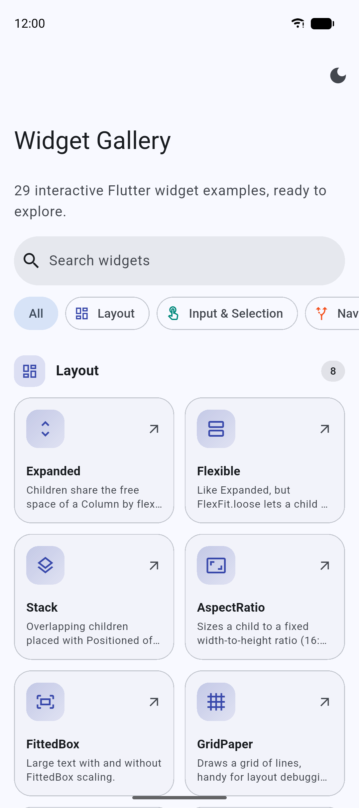
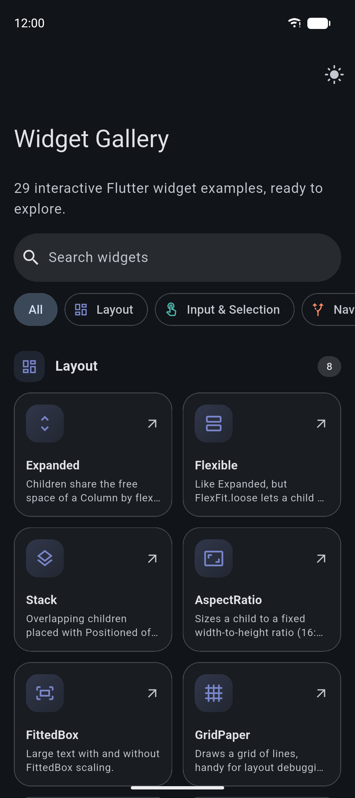
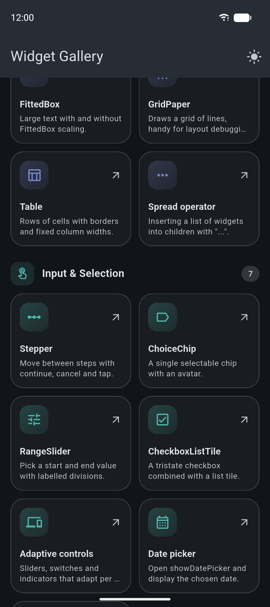
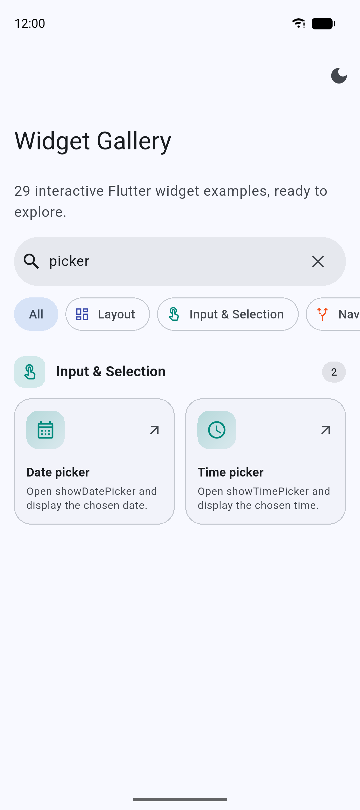
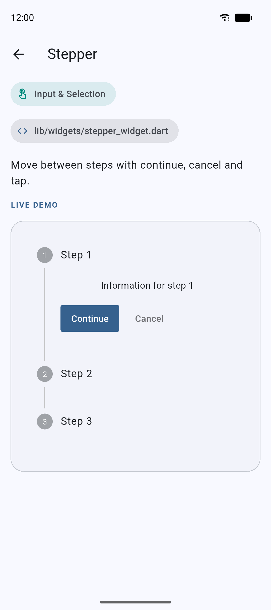
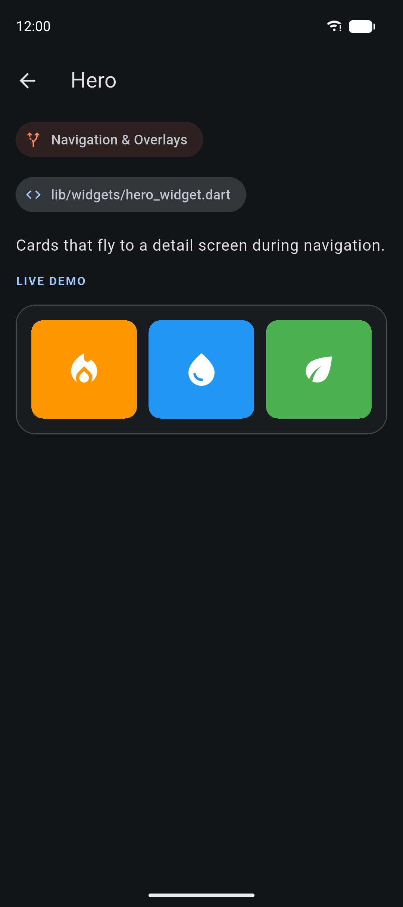

# Flutter Widget Gallery

An interactive Material 3 catalog of commonly used Flutter widgets and UI
patterns. Every example is a small, focused widget you can read, run, and copy
into your own project.

<p align="center">
  
  &nbsp;
  
  &nbsp;
  
</p>

## Features

- **29 interactive examples**, each with a live demo
- **Sections by category**: Layout, Input & Selection, Navigation & Overlays,
  Display & Motion, and Async
- **Live search** and **category filter chips** on the home screen
- **Example pages** showing what each widget does, its category, and the
  source file it lives in
- **Light and dark mode**, toggled from the app bar
- Material 3 design: large collapsing app bar, outlined cards, and a seeded
  color scheme

## Screenshots

| Search | Example page | Example page (dark) |
| :---: | :---: | :---: |
|  |  |  |

## Widget examples

### Layout

| Example | What it demonstrates |
| --- | --- |
| `Expanded` | Children sharing the free space of a `Column` by flex factor |
| `Flexible` | `FlexFit.tight` vs `FlexFit.loose` |
| `Stack` | Overlapping children placed with `Positioned` |
| `AspectRatio` | Sizing a child to a fixed 16:9 ratio |
| `FittedBox` | Large text with and without `FittedBox` scaling |
| `GridPaper` | Drawing a grid of lines for layout debugging |
| `Table` | Rows of cells with borders and fixed column widths |
| Spread operator | Inserting a list of widgets into `children` with `...` |

### Input & Selection

| Example | What it demonstrates |
| --- | --- |
| `Stepper` | Moving between steps with continue, cancel, and tap |
| `ChoiceChip` | A single selectable chip with an avatar |
| `RangeSlider` | Picking a start and end value with labelled divisions |
| `CheckboxListTile` | A tristate checkbox combined with a list tile |
| Adaptive controls | Platform-adaptive sliders, switches, indicators, and icons |
| `showDatePicker` | Opening a date picker and showing the chosen date |
| `showTimePicker` | Opening a time picker and showing the chosen time |

### Navigation & Overlays

| Example | What it demonstrates |
| --- | --- |
| `Hero` | Cards that fly to a detail screen during navigation |
| Slivers | A collapsing `SliverAppBar` with a sliver grid and list |
| `PageView` | Swiping horizontally between pages |
| `BottomNavigationBar` | Switching the selected destination |
| `showModalBottomSheet` | A modal sheet that slides up from the bottom |
| `AlertDialog` | A modal dialog with a title, content, and actions |
| `Tooltip` | Revealing a label on long-press or hover |

### Display & Motion

| Example | What it demonstrates |
| --- | --- |
| `AnimatedCrossFade` | Fading between two children when state changes |
| `Visibility` | Showing or hiding a child |
| `ExpansionTile` | A tile that expands to reveal more items |
| `InteractiveViewer` | Panning and pinch-to-zoom on an image |
| `SelectableText` | Selectable text with live selection output |

### Async

| Example | What it demonstrates |
| --- | --- |
| `FutureBuilder` | Loading and error states of a one-shot `Future` |
| `StreamBuilder` | Loading, streamed values, completion, and error states |

## Requirements

- Flutter SDK with Dart SDK `3.12.0` or newer
- A Flutter device, emulator, or desktop target

## Getting started

```bash
git clone https://github.com/AbdelkaderBarhoumi21/flutter_widget_gallery.git
cd flutter_widget_gallery
flutter pub get
flutter run
```

To see the available devices:

```bash
flutter devices
```

## Development commands

```bash
# Check the project
flutter analyze

# Run the test suite
flutter test

# Format Dart files
dart format .
```

## Project structure

```text
lib/
├── main.dart                     # MaterialApp, light/dark Material 3 themes
├── catalog/
│   └── catalog_example.dart      # Categories and the list of all examples
├── screen/
│   ├── home_screen.dart          # Search, filter chips, and sectioned grid
│   ├── example_screen.dart       # Detail page with the live demo
│   └── sliver_screen.dart
└── widgets/
    ├── catalog_section_title.dart
    ├── catalog_example_tile.dart
    └── *_widget.dart             # One file per example
screenshots/                      # Images used in this README
```

## Adding an example

1. Create a focused widget in `lib/widgets/`.
2. Keep the example interactive when the widget has state or callbacks.
3. Add a `CatalogExample` entry to `catalogExamples` in
   `lib/catalog/catalog_example.dart` with a title, description, icon,
   category, source file, and builder. The home screen, search, and section
   counts update automatically.
4. Add the example to the matching table in this README.
5. Run `flutter analyze` and `flutter test` before opening a pull request.

## Contributing

Contributions that add clear, self-contained Flutter widget examples are
welcome. Please keep examples easy to understand, avoid unnecessary
dependencies, and include any behavior-specific notes in the README.

## Resources

- [Flutter documentation](https://docs.flutter.dev/)
- [Flutter widget catalog](https://docs.flutter.dev/ui/widgets)
- [Dart documentation](https://dart.dev/guides)
